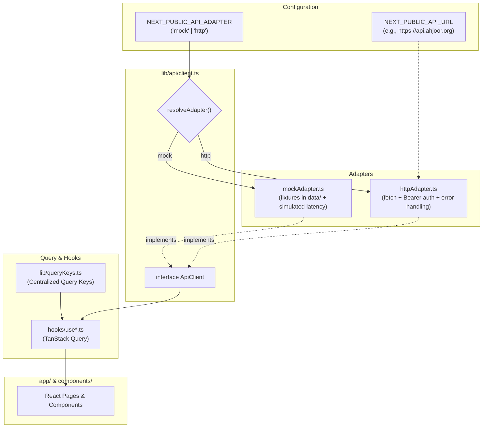

# API Adapters & Data Fetching Guide

This document explains the architecture of the typed API client in `lib/api`, how switching between mock and real HTTP data works via `NEXT_PUBLIC_API_ADAPTER`, and step-by-step instructions for adding new endpoints, query keys, hooks, and migrating pages.

---

## Table of Contents

1. [Architecture Overview & `NEXT_PUBLIC_API_ADAPTER`](#1-architecture-overview--next_public_api_adapter)
   - [Environment Variables & Validation](#environment-variables--validation)
   - [Adapter Resolution (`lib/api/client.ts`)](#adapter-resolution-libapiclientts)
   - [Mock Adapter (`lib/api/mockAdapter.ts`)](#mock-adapter-libapimockadapterts)
   - [HTTP Adapter (`lib/api/httpAdapter.ts`)](#http-adapter-libapihttpadapterts)
2. [Step-by-Step: Adding a New Endpoint](#2-step-by-step-adding-a-new-endpoint)
   - [Step 1: Define the Data Types](#step-1-define-the-data-types)
   - [Step 2: Extend the `ApiClient` Interface](#step-2-extend-the-apiclient-interface)
   - [Step 3: Implement the Method in the Mock Adapter](#step-3-implement-the-mock-adapter)
   - [Step 4: Implement the Method in the HTTP Adapter](#step-4-implement-the-http-adapter)
   - [Step 5: (Optional) Testing Both Adapters](#step-5-optional-testing-both-adapters)
3. [How Query Keys & TanStack Query Hooks Fit In](#3-how-query-keys--tanstack-query-hooks-fit-in)
   - [Query Key Factory (`lib/queryKeys.ts`)](#query-key-factory-libquerykeysts)
   - [Creating Custom Hooks in `hooks/`](#creating-custom-hooks-in-hooks)
   - [Mutations & Cache Invalidation](#mutations--cache-invalidation)
4. [How to Switch a Page from Mock Data to the API Client](#4-how-to-switch-a-page-from-mock-data-to-the-api-client)
   - [The Problem with Direct Fixture Imports](#the-problem-with-direct-fixture-imports)
   - [Before & After Migration Walkthrough](#before--after-migration-walkthrough)
   - [Checklist for Migrating Existing Pages](#checklist-for-migrating-existing-pages)

---

## 1. Architecture Overview & `NEXT_PUBLIC_API_ADAPTER`

The application uses an **Adapter Pattern** to isolate UI components and hooks from data transport details. The frontend can run in two distinct modes without changing component code:



### Environment Variables & Validation

Environment variables are defined in `.env.local` (templated in `.env.example`) and validated at startup in `lib/env.ts`:

- `NEXT_PUBLIC_API_ADAPTER`: Selects `"mock"` (default) or `"http"`.
- `NEXT_PUBLIC_API_URL`: The base URL of your REST backend (e.g. `https://api.ahjoor.com`).

In `lib/env.ts`, Zod enforces cross-field consistency:
```ts
NEXT_PUBLIC_API_ADAPTER: z.enum(["mock", "http"]).default("mock"),
NEXT_PUBLIC_API_URL: optionalEnv(z.string().url()),
```
If `NEXT_PUBLIC_API_ADAPTER` is set to `"http"` and `NEXT_PUBLIC_API_URL` is omitted, `lib/env.ts` fails fast with a validation error during build and startup.

### Adapter Resolution (`lib/api/client.ts`)

The active adapter is selected once at module initialization:

```ts
// lib/api/client.ts
function resolveAdapter(): ApiClient {
  return publicEnv.apiAdapter === "http" ? httpAdapter : mockAdapter;
}

export const apiClient: ApiClient = resolveAdapter();
```

Because `NEXT_PUBLIC_*` variables are inlined at build/bundle time by Next.js, this resolution works consistently across Client Components, Server Components, and test environments.

### Mock Adapter (`lib/api/mockAdapter.ts`)

- **Purpose**: Enables local development, UI prototyping, and offline testing without spinning up backend microservices or databases.
- **Data Source**: Imports static fixtures from `@/data/` (e.g., `MOCK_CIRCLES`, `MOCK_CONTRIBUTIONS`, `MOCK_PAYOUT_HISTORY`).
- **Simulated Latency**: Uses `delay(SIMULATED_LATENCY_MS)` (default 400ms) before returning. This simulates network latency to ensure loading skeletons, spinners, and disabled buttons are always tested during development.
- **Authentication**: Provides mock SEP-10 wallet challenge generation and exchange (`getAuthChallenge`, `exchangeAuthChallenge`).

### HTTP Adapter (`lib/api/httpAdapter.ts`)

- **Purpose**: Communicates with a live REST backend when `NEXT_PUBLIC_API_ADAPTER=http`.
- **Fetch Wrapper (`request<T>`)**:
  - Automatically joins `NEXT_PUBLIC_API_URL` with the endpoint path.
  - Sets standard headers (`Accept: application/json`).
  - Automatically attaches the `Authorization: Bearer <token>` header if a valid session exists via `getAuthToken()` from `lib/api/authToken.ts`.
  - Disables Next.js fetch caching (`cache: "no-store"`) so responses always reflect live server state.
  - Handles `401 Unauthorized` responses by invoking `notifyAuthRequired()`, clearing expired tokens, and alerting wallet/session listeners.

---

## 2. Step-by-Step: Adding a New Endpoint

Suppose we want to add an endpoint for **Savings Goals** (`/api/goals`). Follow these steps:

### Step 1: Define the Data Types

If not already present in `types/`, define the shape of the data model and any creation/update payloads:

```ts
// types/goal.ts
export interface SavingsGoal {
  id: string;
  name: string;
  targetAmount: number;
  targetDate: string;
  circleIds: string[];
  archived: boolean;
  createdAt: string;
}

export interface CreateGoalInput {
  name: string;
  targetAmount: number;
  targetDate: string;
  circleIds?: string[];
}
```

### Step 2: Extend the `ApiClient` Interface

Update `lib/api/client.ts` to include the new methods on the `ApiClient` interface:

```ts
// lib/api/client.ts
import type { SavingsGoal, CreateGoalInput } from "@/types/goal";

export interface ApiClient {
  getCircles(): Promise<DiscoverCircle[]>;
  getCircle(id: string): Promise<DiscoverCircle | null>;
  getContributions(): Promise<ContributionRecord[]>;
  getPayouts(): Promise<PayoutRecord[]>;
  getNotifications(): Promise<Notification[]>;
  getAuthChallenge(address: string): Promise<AuthChallenge>;
  exchangeAuthChallenge(transaction: string): Promise<AuthTokenResponse>;

  // === New Endpoints ===
  getGoals(): Promise<SavingsGoal[]>;
  createGoal(input: CreateGoalInput): Promise<SavingsGoal>;
}
```

TypeScript will immediately warn that `mockAdapter` and `httpAdapter` do not yet satisfy `ApiClient`.

### Step 3: Implement the Mock Adapter

In `lib/api/mockAdapter.ts`, implement the methods using mock fixtures (or in-memory mock state) and `delay()`:

```ts
// lib/api/mockAdapter.ts
import type { SavingsGoal, CreateGoalInput } from "@/types/goal";

// In-memory seed data for mock mode
let mockGoals: SavingsGoal[] = [
  {
    id: "goal-1",
    name: "Emergency Fund",
    targetAmount: 5000,
    targetDate: "2026-12-31",
    circleIds: ["circle-1"],
    archived: false,
    createdAt: new Date().toISOString(),
  },
];

export const mockAdapter: ApiClient = {
  // ... existing methods

  async getGoals(): Promise<SavingsGoal[]> {
    await delay(SIMULATED_LATENCY_MS);
    return [...mockGoals];
  },

  async createGoal(input: CreateGoalInput): Promise<SavingsGoal> {
    await delay(SIMULATED_LATENCY_MS);
    const newGoal: SavingsGoal = {
      id: `goal-${Date.now()}`,
      name: input.name,
      targetAmount: input.targetAmount,
      targetDate: input.targetDate,
      circleIds: input.circleIds ?? [],
      archived: false,
      createdAt: new Date().toISOString(),
    };
    mockGoals.unshift(newGoal);
    return newGoal;
  },
};
```

### Step 4: Implement the HTTP Adapter

In `lib/api/httpAdapter.ts`, implement the methods using the internal `request<T>()` helper:

```ts
// lib/api/httpAdapter.ts
import type { SavingsGoal, CreateGoalInput } from "@/types/goal";

export const httpAdapter: ApiClient = {
  // ... existing methods

  getGoals() {
    return request<SavingsGoal[]>("/api/goals");
  },

  createGoal(input: CreateGoalInput) {
    return request<SavingsGoal>("/api/goals", {
      method: "POST",
      headers: { "Content-Type": "application/json" },
      body: JSON.stringify(input),
    });
  },
};
```

### Step 5: (Optional) Testing Both Adapters

Add unit tests in `lib/api/__tests__/` to verify:
- `mockAdapter` returns the simulated data with simulated latency.
- `httpAdapter` constructs correct URL paths, handles headers, and rejects on errors:

```ts
// lib/api/__tests__/goalsAdapter.test.ts
import { describe, it, expect, vi } from "vitest";
import { mockAdapter } from "../mockAdapter";
import { httpAdapter } from "../httpAdapter";

describe("mockAdapter goals", () => {
  it("returns mock goals", async () => {
    const goals = await mockAdapter.getGoals();
    expect(Array.isArray(goals)).toBe(true);
    expect(goals.length).toBeGreaterThan(0);
  });
});
```

---

## 3. How Query Keys & TanStack Query Hooks Fit In

We do not call `apiClient.getGoals()` directly inside UI components. Instead, we wrap the call with **TanStack Query** (`useQuery` / `useMutation`) and a **Query Key Factory**.

### Query Key Factory (`lib/queryKeys.ts`)

Centralizing query keys prevents typo bugs and enables granular or bulk cache invalidation:

```ts
// lib/queryKeys.ts
export const queryKeys = {
  circles: {
    all: () => ["circles"] as const,
    list: () => ["circles", "list"] as const,
    detail: (id: string) => ["circles", id] as const,
  },
  contributions: {
    all: () => ["contributions"] as const,
    list: () => ["contributions", "list"] as const,
  },
  payouts: {
    all: () => ["payouts"] as const,
    list: () => ["payouts", "list"] as const,
  },
  notifications: {
    all: () => ["notifications"] as const,
  },
  // Add query keys for the new domain:
  goals: {
    all: () => ["goals"] as const,
    list: () => ["goals", "list"] as const,
    detail: (id: string) => ["goals", id] as const,
  },
};
```

#### Why use hierarchical keys?
- `queryKeys.goals.all()` returns `["goals"]`.
- `queryKeys.goals.list()` returns `["goals", "list"]`.
- `queryKeys.goals.detail(id)` returns `["goals", id]`.

When invalidating after a mutation:
```ts
// Invalidates all goal queries (both list and detail views)
queryClient.invalidateQueries({ queryKey: queryKeys.goals.all() });

// Or invalidates only the specific detail query
queryClient.invalidateQueries({ queryKey: queryKeys.goals.detail("goal-1") });
```

### Creating Custom Hooks in `hooks/`

Create a dedicated hook file under `hooks/` (e.g. `hooks/useSavingsGoals.ts`):

```ts
// hooks/useSavingsGoals.ts
import { useQuery, useMutation, useQueryClient } from "@tanstack/react-query";
import { apiClient } from "@/lib/api/client";
import { queryKeys } from "@/lib/queryKeys";
import type { CreateGoalInput } from "@/types/goal";

/** Fetches all savings goals for the active user. */
export function useSavingsGoals() {
  return useQuery({
    queryKey: queryKeys.goals.list(),
    queryFn: () => apiClient.getGoals(),
  });
}

/** Mutation to create a new savings goal with automatic cache invalidation. */
export function useCreateGoal() {
  const queryClient = useQueryClient();

  return useMutation({
    mutationFn: (input: CreateGoalInput) => apiClient.createGoal(input),
    onSuccess: () => {
      // Refresh all goal queries upon successful creation
      queryClient.invalidateQueries({ queryKey: queryKeys.goals.all() });
    },
  });
}
```

---

## 4. How to Switch a Page from Mock Data to the API Client

### The Problem with Direct Fixture Imports

Several legacy pages import mock data arrays directly from `@/data/*`:

```tsx
// ❌ ANTI-PATTERN: Direct fixture import
import { MOCK_CONTRIBUTIONS } from "@/data/contributions";

export default function ContributionsPage() {
  const contributions = MOCK_CONTRIBUTIONS; // Static array!
  return <ContributionList items={contributions} />;
}
```

**Why this breaks:**
1. Setting `NEXT_PUBLIC_API_ADAPTER=http` has **no effect** on this page; it will never talk to the real API.
2. The UI never displays loading skeletons or error banners.
3. Mutations do not trigger refetches.

### Before & After Migration Walkthrough

Let's look at how to migrate a page (e.g., `app/dashboard/contributions/page.tsx`):

#### Before:
```tsx
"use client";

import { useState } from "react";
import { MOCK_CONTRIBUTIONS } from "@/data/contributions";

export default function ContributionsPage() {
  const [filter, setFilter] = useState("all");
  // Hardcoded to mock data:
  const contributions = MOCK_CONTRIBUTIONS;

  return (
    <div>
      <Header />
      <ul>
        {contributions.map((item) => (
          <ContributionRow key={item.id} record={item} />
        ))}
      </ul>
    </div>
  );
}
```

#### After:
```tsx
"use client";

import { useState } from "react";
// 1. Import the TanStack Query hook instead of the fixture
import { useContributions } from "@/hooks/useContributions";
import SkeletonRow from "@/components/ui/SkeletonRow";
import ErrorBanner from "@/components/ui/ErrorBanner";

export default function ContributionsPage() {
  const [filter, setFilter] = useState("all");

  // 2. Consume data, loading, and error states from the hook
  const { data: contributions = [], isLoading, isError, error, refetch } = useContributions();

  // 3. Handle loading state
  if (isLoading) {
    return (
      <div>
        <Header />
        <ul aria-busy="true">
          <SkeletonRow />
          <SkeletonRow />
          <SkeletonRow />
        </ul>
      </div>
    );
  }

  // 4. Handle error state
  if (isError) {
    return (
      <ErrorBanner
        message={error instanceof Error ? error.message : "Failed to load contributions"}
        onRetry={() => refetch()}
      />
    );
  }

  // 5. Render live data (works identically whether mock or http adapter is active!)
  return (
    <div>
      <Header />
      <ul>
        {contributions.map((item) => (
          <ContributionRow key={item.id} record={item} />
        ))}
      </ul>
    </div>
  );
}
```

### Checklist for Migrating Existing Pages

When updating a page to use the API client:

1. [ ] **Verify or Add Hook**: Check if a hook exists in `hooks/` (e.g., `hooks/useContributions.ts`, `hooks/usePayouts.ts`, `hooks/useCircles.ts`). If not, create it using `apiClient` and `queryKeys`.
2. [ ] **Remove Direct Data Import**: Delete the `import { MOCK_* } from "@/data/*"` import in the page component.
3. [ ] **Handle `isLoading`**: Render appropriate placeholder loading UI (e.g. skeletons or spinners) so users get immediate visual feedback while data loads (or during simulated mock delay).
4. [ ] **Handle `isError`**: Render an error message and a retry button calling `refetch()`.
5. [ ] **Layer Optimistic / Local Session State (if needed)**: For pages that allow creating items in demo mode where backend mutation endpoints are not yet online (like `app/dashboard/circles/page.tsx`), layer locally created session items on top of query results:
   ```ts
   const { data: remoteCircles = [] } = useCircles();
   const [localCircles, setLocalCircles] = useState<DiscoverCircle[]>([]);
   const circles = useMemo(() => [...localCircles, ...remoteCircles], [localCircles, remoteCircles]);
   ```
6. [ ] **Verify in Both Modes**:
   - Run `NEXT_PUBLIC_API_ADAPTER=mock pnpm dev` to verify the page loads with simulated latency.
   - Run `NEXT_PUBLIC_API_ADAPTER=http NEXT_PUBLIC_API_URL=https://... pnpm dev` to verify live HTTP fetching.
