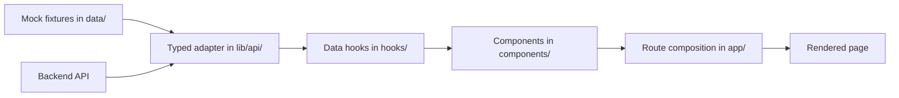

# Project Architecture

The frontend is a Next.js App Router application. Routes compose reusable UI, while hooks and libraries keep state and domain behavior out of presentation where practical. The project can run against bundled mock data or a backend API.

## Folder Responsibilities

| Folder | Responsibility |
| --- | --- |
| `app/` | Route segments and page-level composition. A `page.tsx` file exposes a route; layouts, providers, and global styles establish shared application structure. |
| `components/` | Reusable visual elements, organized by role and feature (for example, `ui/`, `charts/`, `dashboard/`, and `wallet/`). Components render data and forward user actions to hooks or callbacks. |
| `lib/` | Domain logic and integrations that are not tied to React rendering: API adapters, formatting, persistence, calculations, and other reusable services. `lib/api/` is the typed data-access boundary. |
| `hooks/` | Reusable React behavior and state. Data hooks can wrap the API with TanStack Query; interaction hooks can coordinate browser state and domain utilities. |
| `contexts/` | Cross-cutting state shared across parts of the component tree, such as wallet, theme, connection status, and circle comparison state. Providers are mounted from the application setup. |
| `data/` | Bundled fixtures and seed data used for local/demo behavior and other static application content. Mock API adapters import these fixtures. |
| `types/` | Shared TypeScript domain models used by routes, components, hooks, and libraries. Prefer importing a shared type over redefining the same shape at a call site. |

`config/` holds application configuration. For example, `config/features.ts` defines feature-spotlight content and whether each spotlight is active.

## Data Flow

For data-backed features, prefer the typed API and hook path. In mock mode, the adapter reads fixtures in `data/`; with an HTTP adapter configured, it requests data from the backend. A hook exposes loading, error, and result state to the UI. For full implementation details, how `NEXT_PUBLIC_API_ADAPTER` works, and instructions for adding endpoints, see the [API Adapters & Data Fetching Guide](API_ADAPTERS.md).



The diagram describes the preferred path, not every current page. Some existing pages import `data/` directly; when extending those areas, avoid adding new direct fixture dependencies if the feature belongs behind the typed API and a hook.

## Adding a Page or Feature

### New page

1. Add a route segment under `app/` and expose it with a `page.tsx` file. Add a `layout.tsx` only when the route needs a distinct shared shell.
2. Keep the page focused on route-level composition. Put reusable presentation in the closest appropriate `components/` subfolder.
3. Put reusable React state and data fetching in `hooks/`; put framework-independent domain logic or integrations in `lib/`.
4. Use shared models from `types/`. If the page needs server data, extend the typed API and provide a hook rather than coupling presentation to a fixture.
5. Reuse shared providers and components where appropriate, and verify the route with the project lint/build scripts.

### Feature spotlight

`config/features.ts` currently configures **feature spotlights**, not general availability or rollout flags. To add a spotlight, add a uniquely identified entry to `SHIPPED_FEATURES`, then wrap the relevant UI with `FeatureSpotlight` using the same `featureId`. Set `active` to `false` to disable that spotlight globally. The hook remembers user dismissals in local storage.

Do not use `active` to gate the underlying product feature: it only controls whether its spotlight is shown. If a feature needs a true rollout flag, define that separately with an explicit availability/configuration mechanism and use it consistently at the feature boundary.


## Testing Architecture & Best Practices (Issue #332)

### Testing Strategy Overview

The project follows a testing pyramid approach:
- **Unit Tests**: Test individual utilities, hooks, and components in isolation using Vitest + React Testing Library.
- **Integration Tests**: Verify the interaction between multiple components and hooks using real data fixtures.
- **E2E Tests**: Test full user workflows using Playwright, ensuring the UI behaves correctly with real or mock API responses.

### Test Files Organization

- **Component tests**: Place `*.test.tsx` files in a `__tests__/` directory adjacent to the component being tested.
  - Example: `components/cards/Card.tsx` → `components/__tests__/Card.test.tsx`
- **Hook tests**: Place tests in `hooks/__tests__/` and reference the hook under test.
  - Example: `hooks/useGoals.ts` → `hooks/__tests__/useGoals.test.ts`
- **Lib/Utility tests**: Place tests in `lib/__tests__/` for functions in `lib/`.
  - Example: `lib/api/mockAdapter.ts` → `lib/api/__tests__/mockAdapter.test.ts`
- **E2E tests**: Place tests in `e2e/` referencing full app routes.
  - Example: `e2e/dashboard-circles.spec.ts` for `/dashboard/circles` route

### Component Testing Pattern

**Example: Testing a reusable Card component**

```typescript
// components/__tests__/Card.test.tsx
import { describe, it, expect } from "vitest";
import { render, screen } from "@testing-library/react";
import React from "react";
import { Card } from "@/components/cards/Card";

describe("Card Component", () => {
  it("renders title and children content", () => {
    render(
      <Card title="Test Title">
        <p>Test Content</p>
      </Card>
    );
    expect(screen.getByText("Test Title")).toBeInTheDocument();
    expect(screen.getByText("Test Content")).toBeInTheDocument();
  });

  it("applies custom className prop", () => {
    const { container } = render(
      <Card title="Styled Card" className="custom-class">
        Content
      </Card>
    );
    expect(container.querySelector(".custom-class")).toBeInTheDocument();
  });

  it("renders optional footer slot", () => {
    render(
      <Card title="Card with Footer" footer={<button>Action</button>}>
        Content
      </Card>
    );
    expect(screen.getByRole("button", { name: /Action/i })).toBeInTheDocument();
  });
});
```

### Hook Testing Pattern

**Example: Testing a data hook that wraps TanStack Query**

```typescript
// hooks/__tests__/useGoals.test.ts
import { describe, it, expect, beforeEach } from "vitest";
import { renderHook, waitFor } from "@testing-library/react";
import { QueryClient, QueryClientProvider } from "@tanstack/react-query";
import React from "react";
import { useSavingsGoals } from "@/hooks/useSavingsGoals";

describe("useSavingsGoals Hook", () => {
  let queryClient: QueryClient;

  beforeEach(() => {
    queryClient = new QueryClient({
      defaultOptions: {
        queries: { retry: false },
      },
    });
  });

  it("fetches and returns goals", async () => {
    const wrapper = ({ children }: { children: React.ReactNode }) => (
      <QueryClientProvider client={queryClient}>
        {children}
      </QueryClientProvider>
    );

    const { result } = renderHook(() => useSavingsGoals(), { wrapper });

    // Initially loading
    expect(result.current.isLoading).toBe(true);

    // Wait for data to resolve
    await waitFor(() => {
      expect(result.current.isSuccess).toBe(true);
    });

    expect(Array.isArray(result.current.data)).toBe(true);
    expect(result.current.data.length).toBeGreaterThan(0);
  });

  it("handles fetch errors gracefully", async () => {
    // Mock adapter to simulate an error
    const wrapper = ({ children }: { children: React.ReactNode }) => (
      <QueryClientProvider client={queryClient}>
        {children}
      </QueryClientProvider>
    );

    const { result } = renderHook(() => useSavingsGoals(), { wrapper });

    await waitFor(() => {
      expect(result.current.isError).toBe(false); // Adjust based on your mock setup
    });
  });
});
```

### Accessibility Testing

The project uses `vitest-axe` to automatically check for accessibility violations during component tests:

```typescript
import { describe, it, expect } from "vitest";
import { render } from "@testing-library/react";
import { axe, toHaveNoViolations } from "jest-axe";

expect.extend(toHaveNoViolations);

describe("Card Component - Accessibility", () => {
  it("has no accessibility violations", async () => {
    const { container } = render(
      <Card title="Accessible Card">
        <p>Content with proper semantics</p>
      </Card>
    );
    const results = await axe(container);
    expect(results).toHaveNoViolations();
  });
});
```

### Running Tests

- **Run all tests once**: `pnpm test`
- **Run tests in watch mode**: `pnpm test:watch`
- **Run E2E tests**: `pnpm test:e2e` (requires Playwright to be installed: `pnpm exec playwright install chromium`)
- **Run type checking**: `pnpm typecheck`

### Best Practices

1. **Use `screen` queries over container queries**: `screen.getByText()` is more resilient than `container.querySelector()`.
2. **Prefer user-centric testing**: Test what users see and do, not implementation details.
3. **Mock adapters in tests**: For hooks that call `apiClient`, ensure mock or HTTP adapter is configured and test both paths if relevant.
4. **Keep tests focused**: One assertion per test, or group closely related assertions in a single test.
5. **Avoid test interdependencies**: Each test should run independently; use `beforeEach` to set up clean state.
